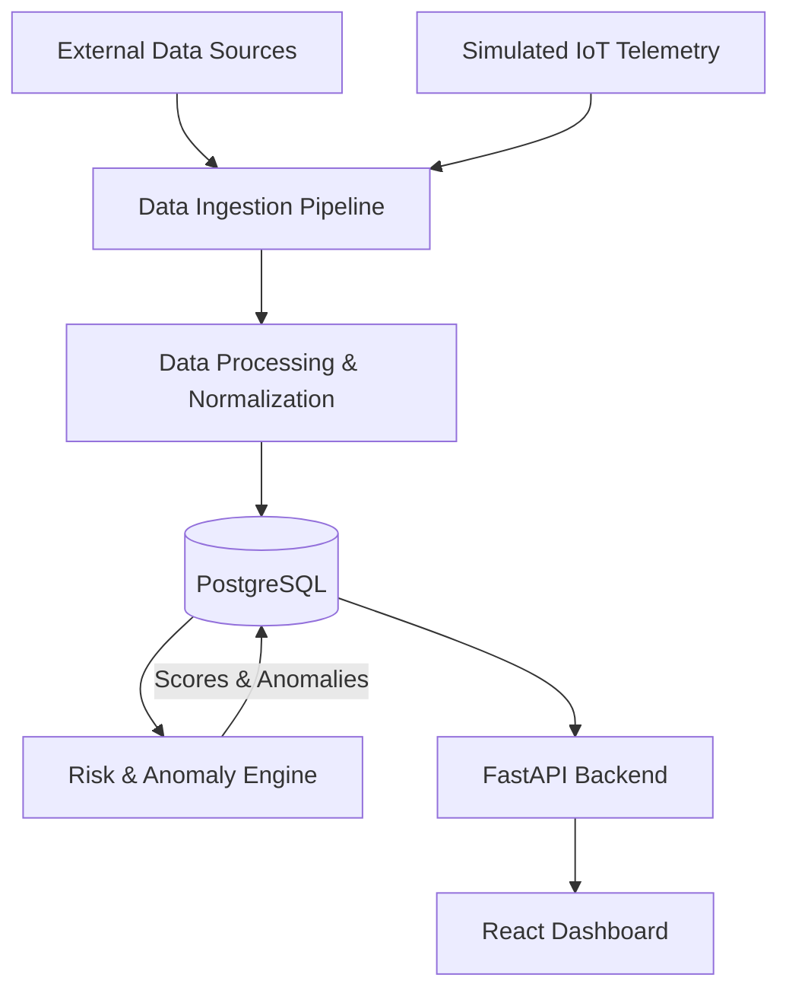

<div align="center">

# CityPulse AI 🌆

[](https://www.python.org/)
[](https://fastapi.tiangolo.com/)
[](https://react.dev/)
[](https://www.typescriptlang.org/)
[](https://www.postgresql.org/)
[](https://vercel.com/)
[](https://render.com/)

**Turning Global Data into Intelligent Decisions.**

CityPulse AI is an urban environmental monitoring and preliminary risk assessment platform that combines public environmental data, simulated IoT telemetry, and heuristic analysis to provide insights across three pilot cities.

[🌐 Live Production Dashboard](https://citypulse-ai-frontend-sigma.vercel.app/) · [🔌 Backend API](https://citypulse-backend-ll7r.onrender.com/api/v1)

</div>

---

## 📋 Table of Contents

1. [About](#-about)
2. [Key Features](#-key-features)
3. [System Architecture](#-system-architecture)
4. [Technology Stack](#-technology-stack)
5. [How It Works](#-how-it-works)
6. [Supported Cities & Indicators](#-supported-cities--indicators)
7. [Getting Started](#-getting-started)
8. [API Documentation](#-api-documentation)
9. [Project Structure](#-project-structure)
10. [Project Limitations](#-project-limitations)
11. [Team & Contributions](#-team--contributions)
12. [Roadmap](#-roadmap)
13. [Acknowledgements](#-acknowledgements)

---

## 📝 About

CityPulse AI is an urban environmental monitoring and preliminary risk assessment prototype. It provides insights into environmental conditions across metropolitan areas using a combination of public APIs, simulated IoT telemetry, and heuristic risk scoring to support informed decision-making.

---

## 🚀 Key Features

- **Multi-City Monitoring:** Tracks environmental conditions in Kuala Lumpur, London, and Tokyo.
- **Environmental Telemetry:** Monitors temperature, humidity, wind speed, rainfall, PM2.5, and PM10.
- **Heuristic Risk Scoring:** Automated 0–100 risk assessments with confidence scores and severity grading.
- **Threshold-Based Anomaly Detection:** Flags threshold breaches for PM2.5 and traffic speed metrics.
- **Modern React Dashboard:** Tailwind-styled interface featuring live telemetry and analytics.
- **Robust FastAPI Backend:** Asynchronous Python API with SQLAlchemy 2.x and Pydantic validation.

---

## 🏗️ System Architecture



---

## 🛠️ Technology Stack

| Category | Technologies |
| :--- | :--- |
| **Frontend** | React 18, TypeScript, Vite, Tailwind CSS, Leaflet |
| **Backend** | Python 3.11, FastAPI, Pydantic, Uvicorn |
| **Database & ORM** | PostgreSQL (Supabase), SQLAlchemy 2.x |
| **Data Engineering** | Open-Meteo API, ingestion pipelines, normalization scripts |
| **AI / ML** | Heuristic risk engines, threshold-based anomaly detection |
| **Cloud & Deployment** | Vercel (Frontend), Render (Backend), Supabase (Database) |

---

## ⚙️ How It Works

1. **Data Collection:** Manual ingestion through the available CLI pipeline using public APIs (Open-Meteo) and simulated IoT telemetry sources.
2. **Data Normalization:** Raw payloads are parsed, validated via Pydantic schemas, and structured into standardized indicator metrics.
3. **Database Storage:** Cleaned records are persisted in a relational PostgreSQL database.
4. **Risk Assessment:** The risk engine evaluates indicator thresholds and computes normalized 0–100 risk scores with confidence levels.
5. **Anomaly Detection:** Threshold-based checks identify deviations for PM2.5 (>100 µg/m³) and traffic speed (<15 km/h) metrics.
6. **API Delivery:** The FastAPI backend serves telemetry, assessments, and health metrics via REST endpoints.
7. **Dashboard Visualization:** The React frontend consumes the API, displaying available city, telemetry, and assessment information.

---

## 🌆 Supported Cities & Indicators

### Pilot Cities

Kuala Lumpur, London, Tokyo.

### Monitored Environmental Indicators

Temperature (°C), Humidity (%), Wind Speed (km/h), Rainfall (mm), PM2.5 ($\mu g/m^3$), PM10 ($\mu g/m^3$).

---

## 🛠️ Getting Started

### Prerequisites

- Python 3.11+
- Node.js 18+ & npm
- PostgreSQL (Local instance or Supabase project)

### 1. Clone the Repository

```bash
git clone https://github.com/dawson-efraim/citypulse-ai.git
cd citypulse-ai
```

### 2. Backend Setup

```bash
cd backend
python -m venv .venv
# Windows PowerShell:
.\.venv\Scripts\Activate.ps1
# macOS / Linux:
source .venv/bin/activate
pip install -r requirements.txt
# Copy and configure environment variables
cp ../.env.example .env
# Edit .env with your values (SUPABASE_URL, DATABASE_URL, etc.)
uvicorn app.main:app --reload --port 8000
```

### 3. Frontend Setup

Open a **separate terminal** for the frontend:

```bash
cd frontend
npm install
# Create .env file with API base URL
echo "VITE_API_BASE_URL=http://localhost:8000/api/v1" > .env
npm run dev
```

The frontend runs on `http://localhost:5173` and communicates with the backend at `http://localhost:8000/api/v1`.

---

## 🔌 API Documentation

The FastAPI backend provides auto-generated OpenAPI documentation at `/docs` (e.g., `http://localhost:8000/docs`).

Core REST Endpoints (all under `/api/v1`):

- `GET /health` — System status.
- `GET /cities` — List monitored areas.
- `GET /observations` — Latest telemetry.
- `GET /assessments` — Risk scores and metrics.
- `GET /alerts` — Active anomaly alerts.
- `GET /indicators` — Supported environmental indicators.
- `GET /sensors` — Sensor metadata.
- `GET /recommendations` — Risk-based recommendations.

---

## 📁 Project Structure

```text
citypulse-ai/
├── ai_engine/            # Anomaly detection and risk scoring logic
├── backend/              # FastAPI application & API routes
├── data_engineering/     # Data ingestion and normalization pipelines
├── database/             # Schemas, migration scripts, and DB seeds
├── docs/                 # Technical documentation
├── frontend/             # React web application
├── iot/                  # IoT simulator and MQTT transport scripts
├── scripts/              # Utility and deployment scripts
├── tests/                # Integration and test suites
├── .env.example          # Environment variable template
└── requirements.txt      # Python dependencies
```

---

## ⚠️ Project Limitations

- **Heuristic Assessment:** Risk scores are calculated using preliminary rule-based thresholds; they are not scientifically validated predictions.
- **Threshold-Based Anomaly Detection:** Anomaly checks are limited to PM2.5 (>100 µg/m³) and traffic speed (<15 km/h).
- **Manual Ingestion:** Data ingestion runs via CLI (`python -m data_engineering.run_ingestion`); no built-in scheduler.
- **No Interactive Map:** Geographic map component removed from current frontend build.
- **Simulated IoT Components:** Some telemetry streams utilize simulated pipelines.
- **Prototype Status:** CityPulse AI is an urban monitoring prototype, not an official emergency warning system.

---

## 👥 Team & Contributions

- **Backend Engineering:** Core API and database integration.
- **Data Engineering & AI/ML:** Ingestion, normalization, and risk engines.
- **IoT & Networking:** Telemetry simulation.
- **Database & Cloud Engineer:** PostgreSQL schema, migrations, and seed scripts.
- **Frontend & Integration:** React UI and responsive styling.

---

## 🗺️ Roadmap

- [x] Phase 1-5: Foundation, Backend, Pipeline, Heuristic Engine, Frontend Redesign.
- [ ] Phase 6: ML Predictive Models & Real-time MQTT Sensor Streaming.
- [ ] Phase 7: Multi-Region Alert Notification Webhooks.

---

## 🏅 Acknowledgements

- **Open-Meteo:** Environmental data source.
- **CartoDB:** Map tiles for geographic visualization.
- **FastAPI / React / Tailwind:** Core technology framework.

---

<div align="center">
  <p>Built for the CityPulse AI Hackathon 2026.</p>
</div>